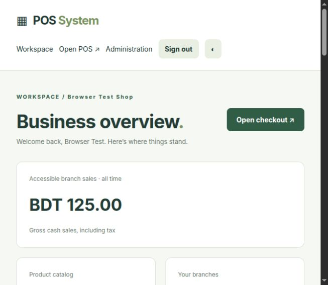
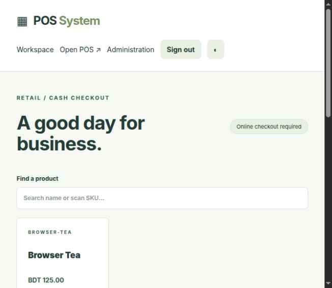
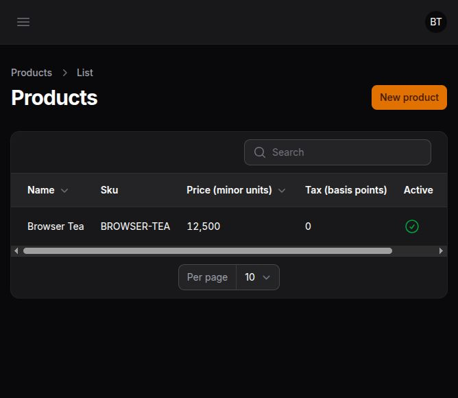
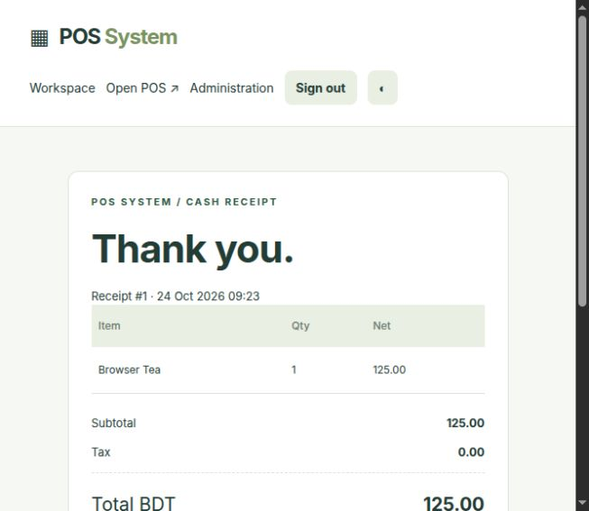
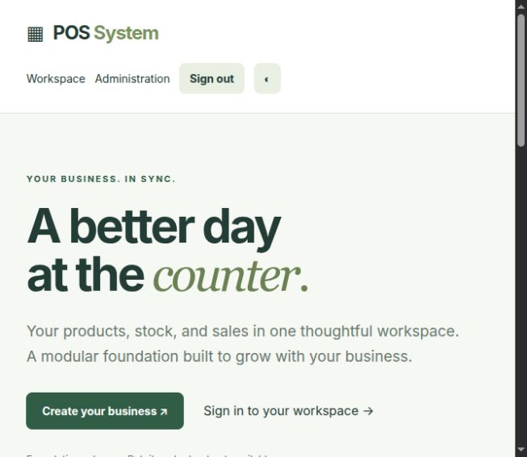

<div align="center">

# POS System

### One Powerful POS. Every Business. Every Branch. Online or Offline.

**A modular Laravel point of sale platform for connected retail operations—and a roadmap toward restaurant, offline, and enterprise business management.**


[Explore the screenshots](#-see-the-application) · [Discover the features](#-features-available-today) · [Start locally](#-installation) · [Read the roadmap](#-the-bigger-opportunity-product-roadmap) · [Connect with Imran](#-lets-connect--collaborate)

[GitHub repository](https://github.com/imranbru99/laravel-pos-system-ai) · Built by **[Imran Ahmed](https://imrandev.bd)** · Laravel · Filament · Livewire · Tailwind CSS

</div>

---

## A better day at the counter

Products in one place. Stock movements you can trace. Cash sales that connect checkout, inventory, and receipts.

POS System brings the everyday retail workflow into a single workspace, with a modular architecture designed to grow as business requirements expand. The aim is to help owners spend less time copying records between tools and more time serving customers, understanding their operations, and developing their business.

> **Current release:** a working, tested **online retail foundation** for development and evaluation. Offline sales, restaurant operations, SaaS billing, and the broader business suite are planned. The tagline describes the product vision. This milestone requires a connection to finalize checkout and is not ready for unrestricted production use.

See the [complete feature matrix](docs/FEATURE_MATRIX.md) for implemented, limited, integration-dependent, and planned capabilities. The [original product requirements](docs/PRODUCT_REQUIREMENTS.md) preserve the full scope.

<a id="-see-the-application"></a>

## 📸 See the application

These are real screenshots from the local application using disposable demonstration data, captured at a narrow browser viewport. They show the current implementation rather than future interface concepts. Click an image to inspect it.

### Business workspace

View gross sales for accessible branches, catalog size, branch access, recent receipts, and stock movements from the business workspace.



### Retail point of sale

Find a product by name or SKU, build a local cart, choose an accessible branch, and complete an online cash sale. Cart clicks and quantity changes do not require a server request each time.



### Filament product administration

Create and edit products through the Filament catalog with searchable names and SKUs, integer prices, configurable exclusive tax, and active status.



### Stored receipts

Open a saved sale to review its line items, subtotal, tax, cash tendered, and change. The print action uses the browser's print dialog.



### Public homepage

A public introduction connects visitors to business registration and sign-in while explaining what is currently available.



## 💼 Why this matters to a business

| Everyday challenge | Current capability | Practical opportunity |
|---|---|---|
| Re-entering sales into a stock sheet | Successful checkout posts sale items and stock issues in one transaction | Reduce duplicate entry between checkout and inventory records |
| Looking up prices manually | Searchable product catalog and SKU input | Keep product selection and pricing in the same workflow |
| Recalculating tax and change | Server-calculated integer totals, exclusive tax, cash tender and change | Reduce repetitive arithmetic and make totals consistent |
| Investigating a stock difference | Recorded positive receipts and negative sale movements | Trace the transactions behind a branch/product quantity |
| Retrying checkout after an uncertain response | Same-payload replay returns the existing sale | Reduce accidental duplicate recording while retrying in the same open tab |
| Finding a past transaction | Saved receipts linked from recent sales | Review recorded transactions without recreating a receipt |
| Keeping unrelated businesses separate | Tenant-scoped business records and branch checks | Evaluate multiple isolated businesses within one application |
| Exposing unnecessary operational screens | Dependency-aware optional module controls | Keep the available workflow focused on enabled capabilities |
| Building on an inflexible prototype | Laravel domains, migrations, Filament policies and automated tests | Extend a documented foundation with reviewable business logic |

These are workflow opportunities, not measured customer outcomes. There are no invented customer counts, revenue improvements, certifications, or productivity benchmarks.

## ⏱️ How much time could your business save?

The largest opportunity is removing repeated work: entering the same transaction twice, manually calculating totals, finding receipts, and checking separate records. Actual savings depend on transaction volume, current processes, training, hardware, and the completed feature set.

Use your own measured numbers:

```text
Monthly hours saved =
    transactions per day
    × seconds saved per transaction
    × operating days per month
    ÷ 3,600
```

**Illustrative planning example only:** if your own evaluation finds a 20-second saving on each of 150 daily transactions across 26 operating days, that equals approximately **21.7 staff-hours per month**.

| Your measured saving per transaction | At 150 transactions/day × 26 days/month |
|---|---:|
| 10 seconds | 10.8 hours/month |
| 20 seconds | 21.7 hours/month |
| 30 seconds | 32.5 hours/month |

The table is arithmetic, **not a benchmark, promise, or measured result for this application**. It excludes training and setup time, support, outages, and any extra validation steps. To assess value, time the same real workflow before and during a controlled evaluation, check accuracy, and apply your actual staffing costs. Planned features should not be counted as current savings.

<a id="-features-available-today"></a>

## ✅ Features available today

### Business registration and organization

- Create an account and business through registration.
- Automatically initialize an isolated tenant, company, and first branch.
- Create additional branches as the business owner.
- Sign in and out through session authentication.
- Regenerate sessions after authentication and apply login/registration throttling.
- Block business operations when the tenant is suspended.

### Product catalog

- Create products from the workspace or Filament administration.
- Edit products through Filament.
- Maintain tenant-specific SKUs with database uniqueness constraints.
- Store selling prices in integer minor units.
- Configure exclusive tax in basis points.
- Activate/deactivate products through administration.
- Generate Unicode product slugs through the reviewed package adapter.
- Preserve Bengali text and resolve tenant-scoped slug collisions.
- Restrict catalog administration to initial owner/manager roles; deny product deletion through its policy.

### Stock receiving and inventory records

- Receive a positive quantity into an accessible branch.
- Record a receipt reference or reason and the acting user.
- Record negative stock movements automatically when a sale completes.
- Derive on-hand quantity from the movement ledger by tenant, branch, and product.
- Reject insufficient-stock checkout.
- Keep stock movements append-only through model hooks.
- Use composite foreign keys to enforce related ownership paths.

Stock receiving in this milestone is a basic ledger receipt. Purchase orders, supplier invoices, valuation, warehouse locations, transfers, counts, and replenishment automation remain planned.

### Retail cash checkout

- Search the active catalog by product name or SKU.
- Use the search field for a keyboard-emulating scanner's SKU input and Enter behavior; physical scanners have not been tested.
- Add products to an in-memory local cart and adjust quantities.
- Select a branch the cashier can access.
- Preview subtotal, exclusive tax, and total locally.
- Validate products, stock, permissions, tax, and tendered cash on the server.
- Post sale, items, stock issues, and audit entry atomically.
- Record cash tendered and calculate change.
- Open a persisted receipt and start another sale.

### Transaction integrity and replay protection

- Give checkout a client-generated UUID.
- Enforce tenant/client-ID uniqueness in the database.
- Hash the validated payload to detect a reused ID with changed content.
- Return the original sale for an exact retry.
- Reject conflicting reuse with HTTP 409.
- Reject updates/deletes of posted sales, sale items, and ledger/audit records through model hooks.
- Roll back invalid operations without leaving a partial sale or stock issue.

Retry protection currently depends on keeping the same browser tab and pending payload. Browser crash/reload recovery and durable offline storage are not implemented. Model immutability also does not prevent privileged direct database changes.

### Receipts and business overview

- Store product names, quantities, unit prices, tax, totals, and currency as sale snapshots.
- Display cash tender and change on the saved receipt.
- Reopen recent receipts within authorized tenant/branch access.
- Print HTML receipts through the browser; an 80 mm CSS content layout is supplied.
- See all-time gross cash sales, including tax, for accessible branches.
- Review recent sales and stock ledger entries.
- Use responsive layouts and a workspace light/dark theme toggle.

### Modular configuration and permissions

- Central module registry: `core → products → inventory → sales → reports`.
- Required foundation modules remain enabled.
- Owners can toggle optional tenant modules.
- Validate dependencies before activation/deactivation.
- Record module changes in the audit log.
- Hide POS navigation and deny checkout when sales are disabled.
- Preserve historical sales and stock records when modules are disabled.
- Apply initial owner, manager, and cashier restrictions plus branch membership checks.

Historical sales remain visible in the base workspace. Full configurable RBAC, a dedicated report center, global/company/branch module overrides, and subscription entitlements are future milestones.

## 🔄 A connected retail workflow


The critical posting steps run inside one database transaction. The server uses stored prices and tax configuration as the authority for the completed sale.

<a id="-the-bigger-opportunity-product-roadmap"></a>

## 🚀 The bigger opportunity: product roadmap

**Everything in this section is planned unless a current subset is explicitly identified above.** These are development opportunities and intended business capabilities, not features being sold as finished.

| Module family | Planned scope | Intended business opportunity |
|---|---|---|
| Offline POS and PWA | IndexedDB queue, authorized devices, versioned snapshots, synchronization, conflicts and recovery | Continue permitted cash sales during network loss, then reconcile safely |
| Restaurant POS | Menus, modifiers, dining areas, tables, waiter orders, split bills and service charges | Connect front-of-house ordering with settlement |
| Kitchen and food inventory | KDS tickets, kitchen stations, timers, recipes, ingredient consumption, yield and waste | Connect preparation activity with stock and food cost |
| Reservations | Availability, guest/party details, deposits, waitlist and no-shows | Coordinate table demand and dining-room activity |
| Registers, payments and refunds | Shifts, cash reconciliation, split payments, returns, exchanges and provider-supported refunds | Connect cashier accountability with payment history |
| Inventory and warehouses | Locations, counts, reservations, batches, expiry, serials, transfers and valuation | Coordinate stock beyond a single basic receipt/issue ledger |
| Purchasing and suppliers | Requisitions, approval, purchase orders, partial receiving, supplier invoices and balances | Link procurement decisions with incoming stock and payables |
| CRM and loyalty | Customer histories, groups, consent, points, tiers, gift cards and store credit | Build repeat-customer workflows with appropriate controls |
| Pricing and promotions | Branch/customer prices, coupons, schedules, quantity rules and stacking | Manage offers through deterministic rules |
| Accounting and finance | Balanced journals, receivables/payables, expenses, taxes, closing and statements | Connect operations with auditable financial postings |
| HR, attendance and payroll | Staff profiles, scheduling, leave, device punches, manual fallback and approved payroll | Coordinate employee administration; jurisdiction configuration required |
| Ecommerce and fulfillment | Storefront, order import, pickup, delivery, connectors and inventory reconciliation | Connect sales channels without double-deducting inventory |
| Manufacturing and assembly | Bills of materials, production, material issues, finished goods and waste | Trace transformations from ingredients/components to saleable products |
| Service businesses | Appointments, work orders, quotations, packages and service history | Extend the catalog into compatible service workflows |
| AI business assistance | Approved catalog drafts, provider abstraction, explanations, usage budgets and recommendations | Assist repetitive analysis/content tasks while retaining human approval |
| Reports and dashboards | Sales, inventory, restaurant, financial, branch and SaaS analytics; exports and schedules | Turn underlying operational records into role-specific decisions |
| SaaS platform | Plans, subscriptions, entitlements, limits, trials, billing, branding and support authorization | Operate a managed service for independent businesses |
| Public website and CMS | Feature/industry pages, pricing, blog, docs, demo, contact, SEO and content administration | Explain the product and manage acquisition content |
| APIs and integrations | Versioned REST, OpenAPI, scopes, webhooks, retries and connector contracts | Connect external systems through explicit, testable contracts |
| Internationalization | English/Bengali translations, RTL, localized documents, currency minor units and exchange histories | Adapt workflows for additional languages and markets |
| Hardware and documents | Tested printer/bridge adapters, scales, displays, attendance terminals and multilingual PDF layouts | Connect software with compatible operational devices |

AI is intended to remain optional. Future payment, attendance, hardware, legal/tax, and country-specific features require appropriate external configuration and validation. No automatic global compliance or universal hardware compatibility is claimed.

### Business types the architecture aims to support

| Business type | Relevant direction | Present evaluation boundary |
|---|---|---|
| Small shops, bookshops and stationery | Simple catalog, stock and counter sales | Current basic online cash workflow |
| Grocery and supermarkets | Barcodes, weighted products, batches, expiry and replenishment | Basic products/cash only; specialist workflows planned |
| Fashion and footwear | Sizes, colors, variants, seasonal pricing and loyalty | Variants and promotions planned |
| Electronics and appliances | Serial tracking, warranties, service and installments | Specialist tracking/service/payment workflows planned |
| Hardware and building materials | Units, bulk pricing, purchasing and warehouse stock | Conversions/wholesale/warehouse workflows planned |
| Restaurants, cafés, bakeries and chains | Menus, recipes, kitchen, tables, takeaway and reservations | Restaurant operations planned |
| Wholesale and distribution | Customer pricing, credit, purchasing, transfers and delivery | Wholesale/distribution workflows planned |
| Franchises and enterprise groups | Companies, branches, permissions and centralized reporting | Basic ownership hierarchy exists; enterprise controls planned |
| Pharmacy where legally appropriate | Batch/expiry and relevant regulated requirements | No pharmacy-specific capability or compliance claim |
| Mixed retail and food service | Independently enabled retail/restaurant capabilities | Restaurant and advanced preset configuration planned |

## 🧱 Architecture and technology

A **modular monolith** keeps business boundaries explicit without requiring a microservice deployment to evaluate the product.

```text
Platform identity
└── Tenant / business
    └── Company
        └── Branch
            ├── Authorized staff access
            ├── Inventory movements
            └── Sales → items → saved receipt
```

| Layer | Technology / implementation |
|---|---|
| Backend | Laravel 12.70.1, PHP; verified on PHP 8.5.4 |
| Administration | Filament 4.15.3, Livewire 3.8.11 |
| Frontend | Blade, JavaScript, Tailwind CSS 4, Vite 7 |
| API preparation | Sanctum 4.3.3 installed; public API/token endpoints pending |
| Data | Eloquent, migrations, composite ownership constraints, transactions |
| Local tests | SQLite; PHPUnit feature tests |
| Production database targets | PostgreSQL/MySQL; runtime/concurrency verification pending |
| Infrastructure configuration | Docker/PHP-FPM, Nginx, PostgreSQL, Redis, queue worker and scheduler |
| Slugs | Reviewed `imrandevbd/laravel-universal-slug` adapter and lock-pinned source |
| Quality | PHPUnit, Laravel Pint, Composer validation/audit, frontend production build |

Exact resolved dependencies are recorded in `composer.lock` and `package-lock.json`. See [architecture](docs/ARCHITECTURE.md) and [database design](docs/DATABASE.md).

### Money and inventory rules

- Initial workflow: BDT, two decimal places.
- Store authoritative money as integer minor units: `12500` means BDT `125.00`.
- Configure exclusive tax in basis points: `500` means `5%`.
- Round each line's tax half-up using integer arithmetic.
- Use server-side product prices/tax for posting; client previews are not authoritative.
- Compute stock from ledger movements rather than a mutable product quantity field.
- Serialize critical commerce operations with a tenant-row lock on supported production databases.

Inclusive/compound tax, discounts, currency switching, valuation, accounting journals, and high-contention production concurrency testing remain open.

## 🔌 ImranDevBD package ecosystem

| Package | Intended role | Current integration status |
|---|---|---|
| [Universal Slug](https://packagist.org/packages/imrandevbd/laravel-universal-slug) | Unicode product/content URLs | Installed, adapter configured, English/Bengali integration tests; source locked in Composer |
| [Drutogoti](https://packagist.org/packages/imrandevbd/drutogoti) | Performance diagnostics and optimization | Initial metadata/docs/source review; runtime integration pending |
| [Laravel Admin Panel](https://packagist.org/packages/imrandevbd/laravel-admin-panel) | Safely reusable administrative utilities | Reviewed separately; default `/admin` overlap/auth boundary documented; not auto-registered |
| [AI Catalog](https://packagist.org/packages/imrandevbd/laravel-ai-catalog) | Governed catalog drafting and enrichment | Evaluated; approval/provenance adapter pending |
| [AI Hub](https://packagist.org/packages/imrandevbd/laravel-ai-hub) | Optional configurable AI providers | Evaluated; provider, permission and cost-control integration pending |
| [Attendance Hub](https://packagist.org/packages/imrandevbd/laravel-attendance-hub) | Compatible device attendance integration | Evaluated; manual fallback/device integration pending |
| [Unicode PDF](https://packagist.org/packages/imrandevbd/laravel-unicode-pdf) | Multilingual business documents | Evaluated; engine/fonts/layout integration pending |

The installed Unicode Slug package uses development source fixed by the lockfile to `9fdcf1659a514e94e7ac58b17ec783e73003fb7b`. Development releases require deliberate review before upgrades. No package source is overwritten inside `vendor/`. Read [integration findings and limitations](docs/INTEGRATIONS.md).

<a id="-installation"></a>

## 🛠 Installation

### Requirements

- **PHP 8.5** to match the tested dependency lock.
- Composer 2 and Node.js 22+ with npm.
- PHP extensions required by Composer, including intl, PDO/database driver, XML, mbstring support and zip.
- SQLite for local evaluation, or an appropriately configured target database.
- A modern browser and online access for checkout.

The application's root PHP constraint is `^8.3`, but the resolved dependency graph can require a newer version. Let Composer enforce platform compatibility; do not use `--ignore-platform-reqs`.

### Start the application

From your checkout directory:

```bash
cp .env.example .env
composer install
php artisan key:generate
php -r "file_exists('database/database.sqlite') || touch('database/database.sqlite');"
php artisan migrate
npm ci
npm run build
php artisan serve
```

Visit the URL printed by Artisan, then open `/register` to create your own business.

For frontend development, run `npm run dev` in another terminal. Set `APP_URL` to your local application URL. Detailed environment, database, workers, and hosting instructions are in the [deployment guide](docs/DEPLOYMENT.md).

### Complete your first sale

1. Register your account and business.
2. Add a product with a name, SKU, price in minor units, and tax basis points.
3. Receive positive stock for that product into your branch.
4. Open POS and select the product.
5. Enter cash tendered in minor units.
6. Complete checkout and open the stored receipt.
7. Review recent sales and inventory movements from the workspace.

### Local demonstration data

Set your own `DEMO_PASSWORD` of at least 12 characters in the local `.env`, then run:

```bash
php artisan db:seed
```

| Scenario | Email | Role |
|---|---|---|
| Demo Retail Store | `retail@demo.pos.test` | Owner |
| Demo Small Shop | `minimal@demo.pos.test` | Owner |

The password is the value you configure; no shared privileged default is provided. Each business gets its own branch and six sample products with opening stock. Seeding only runs in local/testing and skips existing demo accounts; it does not reset their passwords. More roles, restaurant/enterprise scenarios, public demo isolation and reset tools are planned. See [demo guide](docs/DEMO.md).

## 🧭 Routes and access

| Route | Purpose |
|---|---|
| `/` | Public product homepage |
| `/register` | New account/business registration |
| `/login` | Sign in |
| `/app` | Business workspace, product creation, receiving, branches and module controls |
| `/pos` | Online cash checkout when sales are enabled |
| `/receipts/{id}` | Authorized saved receipt |
| `/admin` | Filament administration |
| `/admin/products` | Product administration |

Business mutations use authenticated, CSRF-protected routes with relevant role/branch checks. The current checkout interface is an internal web endpoint, not a supported external REST API. See [HTTP interface](docs/API.md).

## 🛡 Security and operational boundaries

- Tenant-owned Eloquent models require an initialized business context and apply tenant scopes.
- Related business objects use ownership-aware foreign keys.
- Branch checks protect checkout, receiving and receipt access.
- Suspended businesses cannot continue operational routes.
- Product administration uses a policy; cashier management actions are denied.
- Registration validates passwords; authentication uses hashing, session regeneration and throttling.
- No raw payment card information is collected or stored.
- AI/payment/attendance providers make no external runtime calls in this milestone.
- Public/demo evaluation should use disposable data, never live customer or payment data.

Email verification, password-reset UI, MFA, configurable permissions, comprehensive audit administration, API scopes, privacy/retention controls and the complete release security suite remain planned. Review the [security notes](docs/SECURITY.md) before extending the system.

## 🧪 Verification

The latest executed local suite passed **16 tests with 53 assertions** on PHP 8.5.4 and isolated SQLite databases. This is a recorded result, not a live CI badge.

Covered cases include exact totals/stock posting, same-payload replay, conflicting client IDs, underpayment/shortage rollback, cross-tenant IDs, denied branch/management actions, suspended businesses, missing tenant context, module dependencies, immutable records, Unicode slugs, Filament rendering, registration, and authenticated public-homepage rendering.

```bash
composer validate --strict
composer check-platform-reqs
vendor/bin/pint --test
php artisan test
npm run build
composer audit
```

Clean SQLite migrations and demo seeding were executed. A manual browser workflow completed registration → product → receiving → cash sale → persisted receipt. Composer validation/platform/advisory checks, formatting, and the frontend build passed during implementation. A CI workflow is supplied; remote CI execution is not claimed.

No production performance figures are published. MySQL/PostgreSQL contention, full responsive/accessibility coverage, provider sandboxes, physical hardware, PDF generation, offline failure recovery, and complete Docker runtime verification remain pending. See [testing details](docs/TESTING.md).

## 📦 Deployment, queues and recovery

Configuration includes a PHP-FPM application image, Nginx static/frontend serving, PostgreSQL, Redis, queue worker, scheduler, private database networking, and persistent database/storage volumes.

Use the [deployment guide](docs/DEPLOYMENT.md) for local, Docker, VPS and compatible cloud requirements. Use the [operations guide](docs/OPERATIONS.md) for worker supervision, scheduler operation, backups, restore planning, rollback and troubleshooting.

The local `docker` command delegates to Podman and failed on a read-only runtime directory before container verification. Docker files are supplied for staging review; a running container deployment, automatic backup execution and restore drill have not been verified. HTTPS termination and production secret management require deployment configuration.

## 📚 Documentation library

| Guide | What it covers |
|---|---|
| [Feature matrix](docs/FEATURE_MATRIX.md) | Honest completion status and prioritized checklist |
| [Product requirements](docs/PRODUCT_REQUIREMENTS.md) | Full intended application scope and acceptance criteria |
| [Architecture](docs/ARCHITECTURE.md) | Domain structure, tenant context, transactions and design tradeoffs |
| [Database](docs/DATABASE.md) | Entities, ownership constraints, money, tax and stock rules |
| [Modules](docs/MODULES.md) | Registry, dependencies, activation and retained history |
| [Offline](docs/OFFLINE.md) | Current limitation and required reconciliation architecture |
| [Security](docs/SECURITY.md) | Current protections, permissions and remaining hardening |
| [API / HTTP](docs/API.md) | Current web routes and future external API boundary |
| [Deployment](docs/DEPLOYMENT.md) | Installation, environment and staging/production requirements |
| [Demo](docs/DEMO.md) | Local accounts, seeding and evaluation workflow |
| [Testing](docs/TESTING.md) | Executed checks and unexecuted verification |
| [Integrations](docs/INTEGRATIONS.md) | Package compatibility review, source references and limitations |
| [Hardware](docs/HARDWARE.md) | Scanner/printing boundaries and planned adapters |
| [Operations](docs/OPERATIONS.md) | Workers, scheduler, backup/recovery and troubleshooting |
| [Engineering report](docs/ENGINEERING_REPORT.md) | Delivered foundation and remaining release work |

## 🗺 Development milestones

- [x] Inspect workspace and initialize Laravel/Filament foundation.
- [x] Deliver the first tenant → product → stock → sale → receipt workflow.
- [x] Test initial ownership, stock, arithmetic, module and replay controls.
- [x] Add local demos, real screenshots, documentation and infrastructure configuration.
- [ ] Expand organization management, permissions and production database verification.
- [ ] Implement registers/shifts, payment ledger, refunds and purchase receiving.
- [ ] Deliver authorized durable offline sales and reconciliation.
- [ ] Deliver restaurant orders, kitchen, recipes, tables and reservations.
- [ ] Expand procurement, warehouses, CRM, loyalty, accounting and staff workflows.
- [ ] Add tested provider integrations, PDF documents and hardware adapters.
- [ ] Deliver report center, SaaS billing, CMS and remaining public website pages.
- [ ] Complete business presets, demos, onboarding, localization and multicurrency.
- [ ] Complete release security, load, accessibility, backup/recovery and deployment verification.

Suggested repository name, description, and discovery topics: [GitHub metadata](docs/GITHUB_METADATA.md).

## 🤲 Contributing and collaboration opportunities

Useful contributions include reproducible bug reports, meaningful workflow/security tests, accessibility reviews, Bengali/localization work, documented device compatibility checks, provider adapters, database-concurrency verification, and the open milestones above.

For a bug report, include the affected workflow, expected/actual behavior, dependency versions, database, and sanitized reproduction steps. Keep credentials, customer data, card details, and private business records out of public issues. Discuss major module or integration changes before undertaking a broad implementation.

## 📄 License and authorship

This application is distributed under the [MIT License](LICENSE), preserving the repository’s existing copyright notice. Laravel and installed dependencies retain their own copyright and license notices. Contact the developer about commercial collaboration.

First-party developer: **Imran Ahmed** · **[imrandev.bd](https://imrandev.bd)** · **[me@imrandev.bd](mailto:me@imrandev.bd)**.

<a id="-lets-connect--collaborate"></a>

## 🤝 Let's Connect & Collaborate

I am open to **Senior Remote Full-Stack Roles**, **AI Platform Architecture Contracts**, and **Enterprise Technical Advisory**.

- **Timezone:** UTC+6 (Dhaka / Rangpur, Bangladesh) — Flexible overlap with US, UK, and European business hours.
- **Delivery Mode:** Async-ready, Slack, Discord, Jira, GitHub, and production-first accountability.

| Channel | Address / Handle | Quick Action |
|---|---|---|
| 🌐 Primary Portfolio | [imrandev.bd](https://imrandev.bd/) | [Visit Site ↗](https://imrandev.bd/) |
| 📦 Packagist Packages | [packagist.org/packages/imrandevbd/](https://packagist.org/packages/imrandevbd/) | [View Packages ↗](https://packagist.org/packages/imrandevbd/) |
| 💼 LinkedIn Profile | [linkedin.com/in/imranbru99](https://linkedin.com/in/imranbru99) | [Connect ↗](https://linkedin.com/in/imranbru99) |
| 🐙 GitHub Profile | [github.com/imranbru99](https://github.com/imranbru99) | [Follow ↗](https://github.com/imranbru99) |
| 💬 WhatsApp Direct | +880 1576-918420 | [Chat Now ↗](https://wa.me/8801576918420) |
| 📧 Direct Email | [me@imrandev.bd](mailto:me@imrandev.bd) | [Send Email ↗](mailto:me@imrandev.bd) |
| 🐦 X (Twitter) | [@imrandev_bd](https://x.com/imrandev_bd) | [Follow ↗](https://x.com/imrandev_bd) |
| 📺 YouTube Tech | [@ImranDevBD](https://www.youtube.com/@ImranDevBD) | [Subscribe ↗](https://www.youtube.com/@ImranDevBD) |
